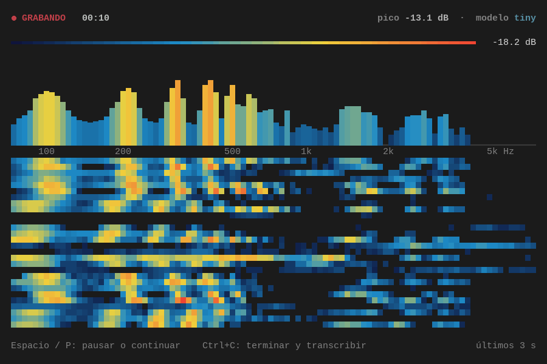

# whisper-tool

Herramienta de terminal que **graba el audio que suena en tu equipo** (bocinas o audífonos), muestra un
**espectrograma en vivo** y lo **transcribe a texto** con [faster-whisper](https://github.com/SYSTRAN/faster-whisper).
Sirve para transcribir audios que no se pueden descargar como archivo (por ejemplo, reproductores incrustados en
páginas web). Todo corre en local: el audio no sale de tu equipo.



## Requisitos

- Linux con **PipeWire** (usa `pw-record`).
- Python 3.9 o superior.
- Una terminal con colores de 24 bits (Konsole, GNOME Terminal, etc.).
- Conexión a internet la primera vez, para descargar el modelo elegido.

No hace falta instalar ffmpeg ni tener GPU.

## Uso

```bash
./whisper-tool
```

La primera ejecución crea el entorno virtual (`.venv-whisper/`) e instala las dependencias automáticamente.

### Modelos

| Modelo | Descarga aprox. | Notas |
|---|---|---|
| `tiny` | ~75 MB | el más rápido, menos preciso |
| `base` | ~145 MB | equilibrado |
| `small` | ~480 MB | buena precisión |
| `medium` | ~1,5 GB | muy preciso, lento en CPU |
| `large-v3` | ~3 GB | el más preciso, muy lento en CPU |

Los modelos se descargan de Hugging Face la primera vez que se usan y quedan en `~/.cache/huggingface`. El menú marca con ✔ los que ya tienes descargados; al elegir uno que no lo está se descarga mostrando una barra de progreso. Una vez descargado, las siguientes ejecuciones se saltan el menú y usan el último modelo (se recuerda en `.whisper-tool.json`). En la pantalla de inicio, `M` abre el menú para cambiar o descargar otro modelo.

### Controles

| Tecla | Acción |
|---|---|
| `↑` / `↓` o `1`-`5` | elegir modelo en el menú |
| `Enter` / `Espacio` | preparar la grabación (empieza sola al detectar sonido) |
| `M` | cambiar o descargar otro modelo (pantalla de inicio) |
| `Espacio` / `P` | pausar o reanudar; si está esperando sonido o en pausa por silencio, empezar o seguir ya |
| `Ctrl+C` | terminar y transcribir |
| `Q` | salir sin grabar (en las pantallas iniciales) |

### Grabación automática

- **Empieza sola:** tras `Enter`, la herramienta espera a que suene algo y entonces empieza a grabar (conservando el medio segundo anterior, para no cortar el principio). Con `Espacio` o `P` empieza al momento.
- **Se pausa sola:** tras 12 segundos de silencio la grabación se pausa (no se cierra) y sigue cuando vuelve el sonido. Los silencios largos no se graban ni se transcriben. Termina con `Ctrl+C`.
- **Aviso de volumen bajo:** si el audio se oye pero muy bajo, se avisa en pantalla y al terminar, porque la transcripción puede salir peor.

Las grabaciones y transcripciones se guardan en `records/`:

| Archivo | Contenido |
|---|---|
| `grabacion_AAAAMMDD_HHMMSS.wav` | el audio (se va escribiendo mientras grabas, así un cierre inesperado no lo pierde) |
| `grabacion_AAAAMMDD_HHMMSS.txt` | la transcripción, en párrafos (uno nuevo tras cada pausa larga) |

Al transcribir verás una barra de progreso con cada frase y su tiempo; al terminar se indica cuánto tardó y el texto se copia al portapapeles (necesita `wl-clipboard` o `xsel`). Si la transcripción falla o la cancelas con `Ctrl+C`, el audio ya está guardado y puedes reintentar con `R` o salir con `Q`.

La interfaz se adapta al tamaño de la terminal: el espectro y el espectrograma ocupan el espacio disponible, se
ajustan si redimensionas la ventana y se centran en pantallas anchas. Mientras grabas se ve el tiempo, el pico de
nivel y el modelo en uso.

### Pruebas

```bash
./.venv-whisper/bin/python src/smoke_test.py
```

Graba frases sintéticas (suenan por las bocinas, hace falta `espeak-ng` y el modelo `tiny`) y comprueba la espera de sonido, la pausa automática, el audio, el texto en párrafos y el aviso de volumen bajo. Usa un directorio temporal: no toca tus grabaciones ni tu configuración.

### Transcribir un archivo existente

```bash
./.venv-whisper/bin/python src/transcribe.py audio.mp3 [modelo]
```

## Notas

- La transcripción está fijada en **inglés** (`language="en"`). Para otro idioma, cambia ese valor en
  `src/grabar.py` y `src/transcribe.py`.
- Se captura **todo** el sonido del equipo: silencia notificaciones y música.
- Los silencios se filtran antes de transcribir para evitar texto inventado; si no hay audio, el panel avisa de que no hay señal.

